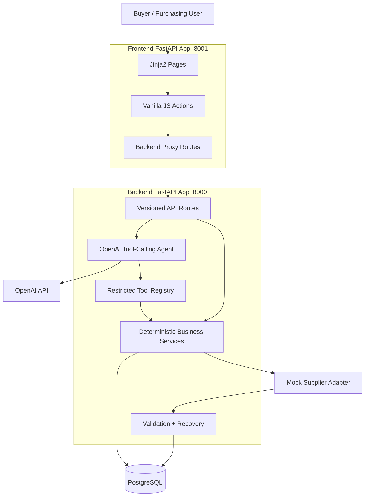
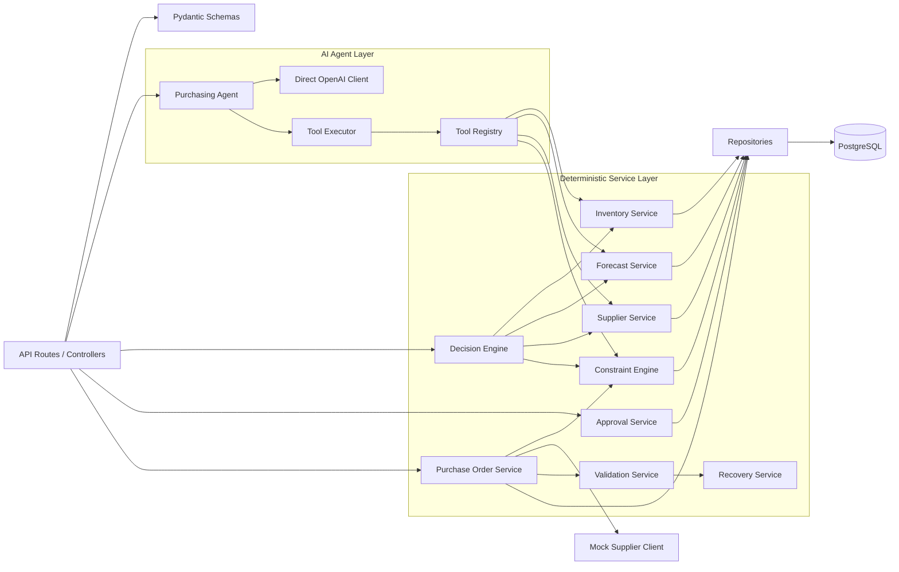
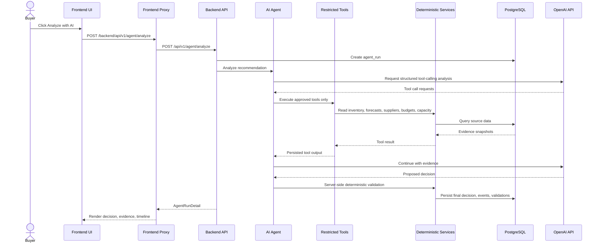
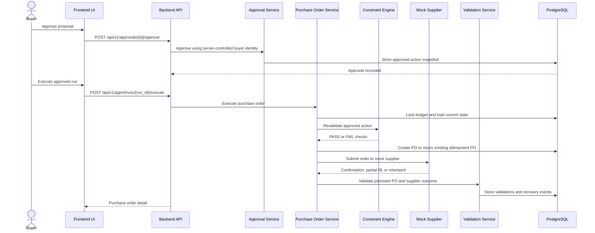
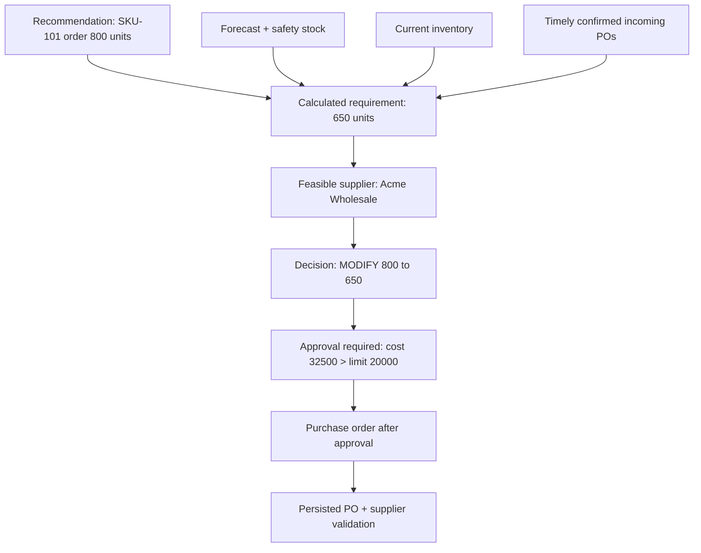

# Architecture

This document explains how the AI Purchasing Agent works functionally and technically. The implementation is intentionally split into two FastAPI applications:

- Backend on `localhost:8000`: owns PostgreSQL, purchasing rules, AI analysis, approvals, purchase-order execution, validation, and recovery events.
- Frontend on `localhost:8001`: renders Jinja2 HTML pages and talks to the backend over HTTP only.

The current demo is optimized around Scenario 1: a buyer reviews an inflated recommendation for `SKU-101`, asks the agent to analyze it, approves the corrected proposal, executes a purchase order, and inspects validation.

## High-Level Architecture



The frontend is deliberately thin. It presents dashboard, recommendation, approval, agent-run, and purchase-order screens, then sends requests to backend endpoints. It does not connect to PostgreSQL, does not perform business calculations, and does not call OpenAI directly.

The backend is the system of record. It validates data, executes constrained decisions, persists agent evidence, enforces approval policy, creates purchase orders idempotently, and records recovery events if supplier outcomes do not match the approved action.

## Backend Component View



The code follows an MVC-style separation:

- Models define persistent domain entities such as products, inventory, suppliers, recommendations, agent runs, approvals, and purchase orders.
- Controllers are FastAPI route modules. They parse requests, call services, and return schemas.
- Views are frontend Jinja2 templates. They render data and trigger HTTP actions, but contain no database or purchasing logic.
- Services contain deterministic purchasing behavior and are kept testable through clear dependencies.
- Repositories isolate SQLAlchemy database access from service logic.

## Functional Flow: Recommendation Analysis



The agent can investigate only through the registered tools. Tool calls and outputs are persisted, so the timeline page shows actual evidence rather than generated UI text. The deterministic decision engine always recalculates the safe business decision before the proposal is stored.

## Functional Flow: Approval, Execution, And Validation



Execution is intentionally stricter than approval. A proposal approved yesterday can still fail at execution if budget, supplier availability, storage capacity, or incoming orders changed. Duplicate execution requests reuse the existing order instead of creating unsafe duplicate POs.

## SKU-101 Scenario Data Flow



For the seeded demo, the recommendation says to buy `800` units of `SKU-101`, but deterministic demand projection calculates a requirement of `650`. The selected supplier can fulfill `650`, the total expected cost is `32500`, and the proposal requires human approval because it exceeds `PURCHASE_AUTO_APPROVAL_LIMIT=20000`.

## AI Vs Deterministic Responsibilities

| Area | AI Agent Responsibility | Deterministic Backend Responsibility |
| --- | --- | --- |
| Investigation | Decide which approved tools to call and summarize evidence. | Restrict tool access, validate arguments, persist tool calls, and enforce call limits. |
| Recommendation reasoning | Explain risks, missing information, and why a change may be needed. | Recalculate demand, supplier feasibility, constraints, approval requirement, and final safe decision. |
| Supplier selection | Propose a supplier based on available tool evidence. | Verify availability, MOQ, order multiples, lead time, storage capacity, budget, and duplicate order safety. |
| Approval | Explain why approval is needed. | Create approval requests from server-side policy and use server-controlled buyer identity. |
| Execution | No direct execution authority. | Revalidate inside a transaction, create idempotent purchase orders, update budgets, and call the supplier adapter. |
| Recovery | Surface risk in the explanation. | Detect mismatches or partial fulfillment, mark validation failed, and create visible recovery events. |

The LLM is useful for investigation and explanation, but it is never trusted as the source of truth for purchase authority. If the LLM proposal differs from deterministic validation, the backend records an audit note and stores the server-corrected decision.

## Important Tables

| Table | Purpose |
| --- | --- |
| `products` | Product catalog, including SKU metadata and unit volume used for storage checks. |
| `warehouses` | Warehouse capacity and location data. |
| `inventory` | On-hand and reserved quantity by product and warehouse. |
| `forecasts` | Daily demand projections used for planning-horizon calculations. |
| `suppliers` | Supplier master data and operational status. |
| `supplier_products` | Supplier catalog rows, including price, MOQ, order multiple, lead time, and available quantity. |
| `budgets` | Budget limits and committed/spent amounts used during approval and execution. |
| `purchase_recommendations` | Buyer-facing recommendations that can be analyzed by the agent. |
| `agent_runs` | One persisted analysis run per agent invocation, including workflow state and final structured decision. |
| `agent_tool_calls` | Auditable tool inputs and outputs generated during agent investigation. |
| `agent_events` | Timeline events shown in the frontend agent-run detail page. |
| `agent_validations` | Pre-execution, post-execution, and supplier outcome validation results. |
| `approval_requests` | Human approval records with approved or rejected action snapshots. |
| `purchase_orders` | Executed purchase orders, statuses, supplier confirmation data, and idempotency keys. |

## Constraint Model

The constraint engine returns explicit `PASS`, `FAIL`, or `UNKNOWN` checks. Important checks include:

- Budget availability.
- Supplier availability and active status.
- Minimum order quantity.
- Order multiple rounding.
- Delivery timing against required-by date.
- Duplicate purchase-order prevention.
- Warehouse storage capacity using `on_hand_quantity * product.unit_volume`.
- Invalid or missing data detection.

When no supplier is feasible, the decision becomes `INVESTIGATE` and the response includes supplier-level reasons such as budget failure, late delivery, storage capacity, or supplier shortage.

## Tooling And Diagnostics

Use these backend commands from `ai-purchasing-agent/backend`:

```bash
python app/reset_demo_db.py
python app/verify_demo_db.py
python app/diagnose_recommendations.py
```

`reset_demo_db.py` rebuilds the schema and reloads realistic demo data. `verify_demo_db.py` confirms expected table counts, supplier catalog rows, and warehouse volume capacity. `diagnose_recommendations.py` prints each recommendation, calculated requirement, supplier options, constraint failures, and deterministic decision.

The supplier catalog table is named `supplier_products`. If it has zero rows, the agent will not find feasible suppliers and analysis will naturally fall into investigation.

## Design Principles

The implementation favors clear separation of responsibilities:

- Controllers orchestrate HTTP requests only.
- Services own business rules and are tested independently.
- Repositories encapsulate persistence details.
- Tool execution uses a registry and executor so the agent cannot run arbitrary SQL or browser-supplied evidence.
- Supplier integration is behind an adapter so the mock supplier can be replaced later.
- Validation and recovery are separate from PO creation so execution results remain auditable.

This keeps the buyer workflow understandable while preserving the safety properties expected from an automated purchasing system.
